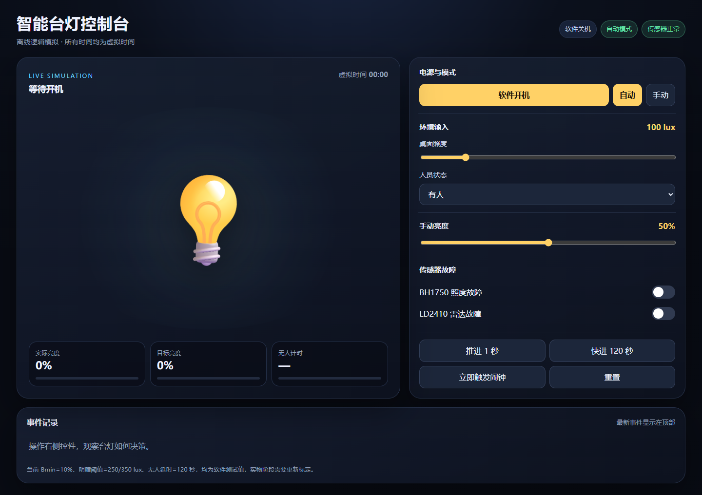
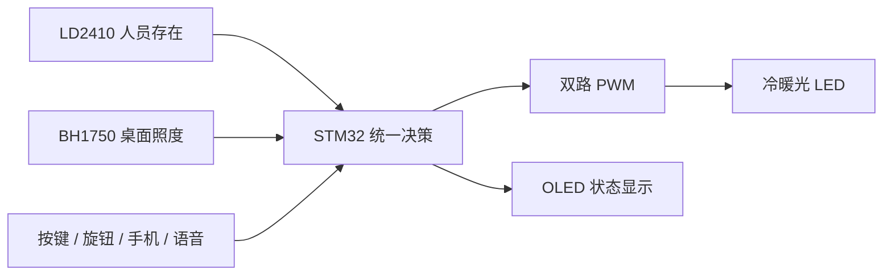

# STM32 Smart Desk Lamp

基于 STM32 的自适应智能台灯项目，目标是根据人员存在状态和桌面照度自动补光，并提供手动控制、平滑调光、故障降级和闹钟提醒。

> **当前状态：软件控制逻辑已完成电脑端模拟和自动化测试；NUCLEO-F411RE的Keil工程骨架已通过编译与链接；开发板下载、传感器、灯具及整机尚未完成实物验证。**



## 已经完成

- 自动模式：明亮环境保持关灯，暗环境有人时自动补光；
- 手动模式：用户亮度指令优先，传感器不覆盖手动设定；
- 照度迟滞：使用 `250/350 lux` 双阈值，减少临界亮度附近反复开关；
- 平滑调光：按虚拟时间渐亮和渐暗，不使用阻塞等待；
- 人员离开：先降至 `10%` 待机亮度，有效无人累计 `120 s` 后关闭；
- 传感器故障：BH1750 异常时冻结自动亮度，LD2410 异常时冻结无人计时；
- 通信恢复：LD2410 连续收到3帧有效数据后恢复人员控制；
- 闹钟提醒：支持单次/每日策略、呼吸亮度、按键停止和原状态恢复；
- 自动化测试：23项测试覆盖配置、调光、模式、故障、闹钟和综合场景。
- F411RE工程：Arm Compiler 6.24构建为AXF/HEX，当前骨架0错误、0警告；尚未下载到开发板。

## 系统计划



当前仓库中的 Python 模拟器对应上图的“统一决策”部分，用确定性输入验证状态机和异常策略。传感器驱动、PWM 输出和通信将在 STM32 开发板阶段替换为真实外设。

## 快速运行

需要 Python 3，不依赖第三方 Python 包。

```powershell
cd simulator
python run_demo.py
python -m unittest discover -s tests -v
```

Windows 也可以双击：

- `simulator\open_ui.cmd`：打开离线图形模拟器；
- `simulator\run_demo.cmd`：运行综合时间线；
- `simulator\run_tests.cmd`：运行全部测试。

## 仓库结构

```text
simulator/                 已验证的电脑端控制逻辑与测试
firmware/                  F411RE控制核心、Keil工程、构建脚本与引脚合同
docs/requirements.md      功能需求与行为规则
docs/architecture.md      软件结构、数据流和状态机
docs/hardware-plan.md     STM32 测试版硬件计划
docs/test-report.md       当前软件测试证据与硬件待测项
docs/roadmap.md           从需求到实物与答辩材料的完整流程
```

## 进一步阅读

- [功能需求](docs/requirements.md)
- [软件架构](docs/architecture.md)
- [硬件计划](docs/hardware-plan.md)
- [测试报告](docs/test-report.md)
- [项目路线图](docs/roadmap.md)
- [固件工作区](firmware/README.md)
- [V1接线计划](docs/wiring-v1.md)
- [硬件到货验收单](docs/arrival-checklist.md)

## 验证边界

本仓库当前证明的是需求建模、状态机设计、非阻塞时间逻辑、异常处理和自动化测试能力。它还不能证明 STM32 外设驱动、传感器精度、LED 电气安全、实物照度效果、PCB 正确性或整机稳定性。这些内容会在完成实测后按证据逐步加入。

## License

本仓库中原创的模拟器代码和文档采用 [MIT License](LICENSE)。未确认授权的参考项目和第三方资料不上传。
