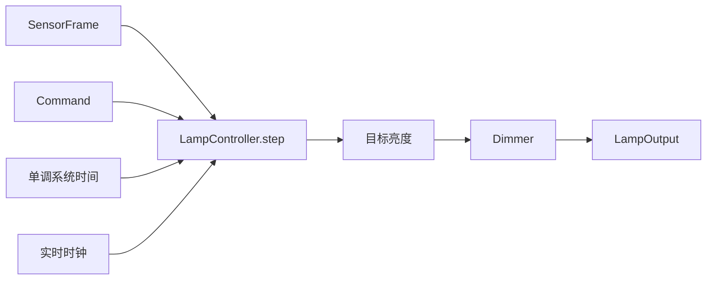
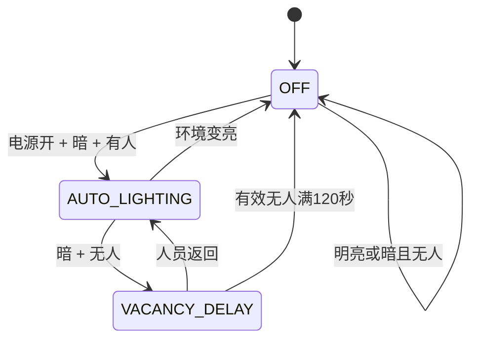

# 软件架构

## 1. 数据流

传感器只负责生成输入，用户接口只负责生成命令。`LampController` 是唯一决策中心；硬件迁移后，PWM驱动只执行 `LampOutput`，不重复实现业务规则。

## 2. 模块职责

| 文件 | 职责 |
| --- | --- |
| `model.py` | 枚举、命令、配置、传感器帧和输出数据结构 |
| `controller.py` | 模式切换、自动决策、故障降级、无人延时和闹钟协调 |
| `dimmer.py` | 基于时间差向目标亮度移动，避免越界和超调 |
| `alarm.py` | 单次/每日闹钟判定和呼吸亮度曲线 |
| `simulator.py` | 推进虚拟时间，连接输入、命令和控制器 |
| `run_demo.py` | 展示人员离开、故障恢复、延时关闭和闹钟的综合时间线 |

## 3. 自动状态机

手动模式是控制模式，不与自动状态混用。用户设置亮度后进入手动模式，直到发出“自动模式”命令。

## 4. 非阻塞时间设计

控制器接收单调递增的 `now_s`，用时间差计算渐变和延时，不通过睡眠或长时间阻塞等待。迁移到STM32时，`now_s` 替换为系统节拍，主循环或RTOS任务周期调用控制器。

## 5. STM32迁移映射

| 电脑模拟 | STM32实现 |
| --- | --- |
| `SensorFrame` | BH1750与LD2410驱动更新的输入快照 |
| `Command` | 旋钮、按键、手机或语音统一生成的事件 |
| `now_s` | `HAL_GetTick()`或独立单调节拍 |
| `LampOutput` | PWM目标值、OLED状态和故障提示 |
| Python数据类/枚举 | C结构体和枚举 |

首个STM32版本优先使用稳定裸机状态机；只有在裸机版本验证后，才将采集、控制和通信拆分为FreeRTOS任务。
